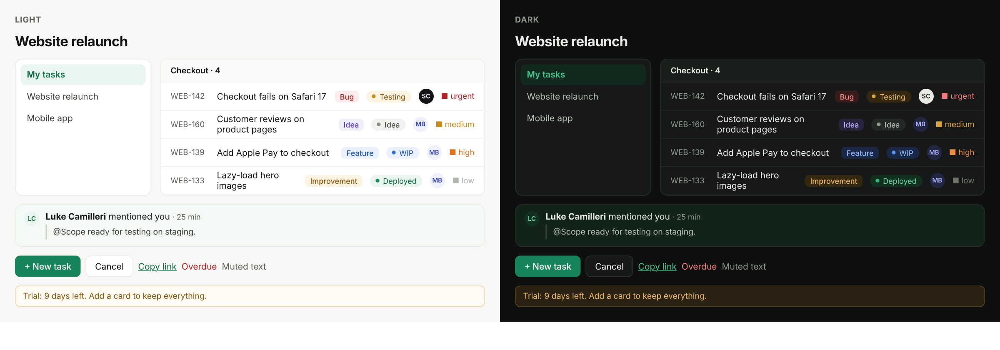

# BornTask dark mode: colour scheme and build notes

## Files

| File | What |
|---|---|
| `src/theme/palettes.ts` | `light` and `dark` palettes with identical keys: base colours, task types, status tones, priorities, roles, avatars |
| `src/theme/antdThemes.ts` | `antdThemeFor(mode)`: AntD 6 theme with `darkAlgorithm` for dark |
| `src/theme/theme.css` | The same colours as CSS variables (`--bt-*`) for light, dark and "System" |

## Core colours

| Token | Light | Dark | Used for |
|---|---|---|---|
| canvas | `#F7F8F6` | `#0E100F` | Page background |
| surface | `#FFFFFF` | `#161917` | Cards, sidebar, top bar, lists |
| raised | `#FFFFFF` | `#1E221F` | Popovers, drawer, modals (lighter = closer in dark) |
| subtle | `#FAFBF9` | `#1B1F1C` | Group headers, hover |
| chip | `#F1F2EF` | `#252926` | Neutral fills |
| border | `#E8EBE6` | `#2C312D` | Card and input borders |
| divider | `#EEF0EC` | `#232724` | Row separators |
| ink | `#121417` | `#E8EBE5` | Main text |
| ink3 | `#3A3F38` | `#B8BEB3` | Secondary text |
| muted | `#5B6157` | `#8F968B` | Labels, meta, timestamps |
| faint | `#8A9086` | `#6E756A` | Placeholders, disabled (never essential text) |
| brand | `#178A5C` | `#2FB57A` | Logo tile, focus ring, selected, progress |
| brandFill | `#15845A` | `#15845A` | **Primary buttons** (white text) |
| brandText | `#0F6B46` | `#4CC48F` | Links, green text |
| brandTint | `#E9F5EF` | `#122A1E` | Selected nav, allowed drop column |
| unreadRow | `#F3FAF6` | `#122319` | Unread notifications |
| danger | `#B42323` | `#F27C7C` | Errors, overdue |
| warning | `#8A5A0B` | `#E8B75F` | Banners, warnings |

Task types, status tones, priorities, roles and avatars each have a dark version in `palettes.ts`. Dark tags use a deep tint of the hue as the background and a light version as the text.

## Contrast (checked with the WCAG formula)

- Main text on surface: 14.7:1. Muted text: 5.8:1 on surface and 5.5:1 on subtle.
- Every type tag, status pill and avatar: at least 5.7:1.
- Status dots and priority marks: at least 3.7:1.
- **Primary button: white on `#15845A` = 4.69:1 in both modes.** The old `#178A5C` was 4.35:1, which fails AA for 14 px text. **This changes light mode too.** The difference is barely visible, and the logo stays `#178A5C`.

## How the mode is chosen

1. **Profile → Appearance:** System (default) / Light / Dark. Stored in `localStorage` (`bt-theme`) on this device. Not synced to the server yet.
2. **Set `<html data-theme="system|light|dark">`.** `theme.css` handles the rest: "system" follows `prefers-color-scheme`.
3. **Avoid a white flash:** in `index.html`, before the app bundle, add a tiny inline script that reads `localStorage` and sets `data-theme`.
4. **AntD:** wrap `ConfigProvider` with `theme={antdThemeFor(resolvedMode)}`, where `resolvedMode` resolves "system" using `matchMedia('(prefers-color-scheme: dark)')` and listens for changes.
5. **Keyboard shortcut:** optional; Shift+D in the shortcuts sheet.

## Integration

1. Copy the three files into `src/theme/`.
2. Import `theme.css` **after** `global.css` in `main.tsx`, and delete the old `:root { … }` colour block from `global.css`.
3. Replace `ConfigProvider theme={antdTheme}` with `theme={antdThemeFor(mode)}`.
4. **Replace hard-coded hex colours in components with variables or `palette(mode)` values.** The first handoff has about 40 inline uses of `#5B6157` and around 100 hard-coded colours overall. **Dark mode only works as far as this replacement goes.** Add a `design:lint` rule that fails on hex colours outside `src/theme/`.

| Was | Use |
|---|---|
| `#5B6157` | `var(--bt-muted)` |
| `#3A3F38` | `var(--bt-ink3)` |
| `#121417` | `var(--bt-ink)` |
| `#E8EBE6` | `var(--bt-border)` |
| `#FAFBF9` | `var(--bt-subtle)` |
| `#178A5C` (as text or border) | `var(--bt-brand)` |
| `#0F6B46` | `var(--bt-brand-text)` |
| `#B42323` | `var(--bt-danger)` |
| `typeStyle[t].bg` / `.fg` | `var(--bt-type-<t>-bg)` / `-fg` |
| `toneStyle[t]` | `var(--bt-tone-<t>-bg/-fg/-dot)` |
| Scope's black avatar | `var(--bt-me-avatar-bg/-fg)` (inverts in dark) |

## Rules

- **No pure black or pure white backgrounds in dark.** Surfaces get lighter as they rise (canvas → surface → raised).
- **Shadows barely show on dark.** Popovers and drawers always get a 1 px `border` as well.
- **Images and screenshots in tasks stay as they are.** Optionally add a subtle 1 px border so white screenshots don't glare.
- **Logo:** the green tile works on both backgrounds; no dark variant is needed.
- **Emails stay light.** Most email clients handle their own dark mode.
- **Charts (v2, Recharts):** take series colours from the tone `dot` values in the current palette.
